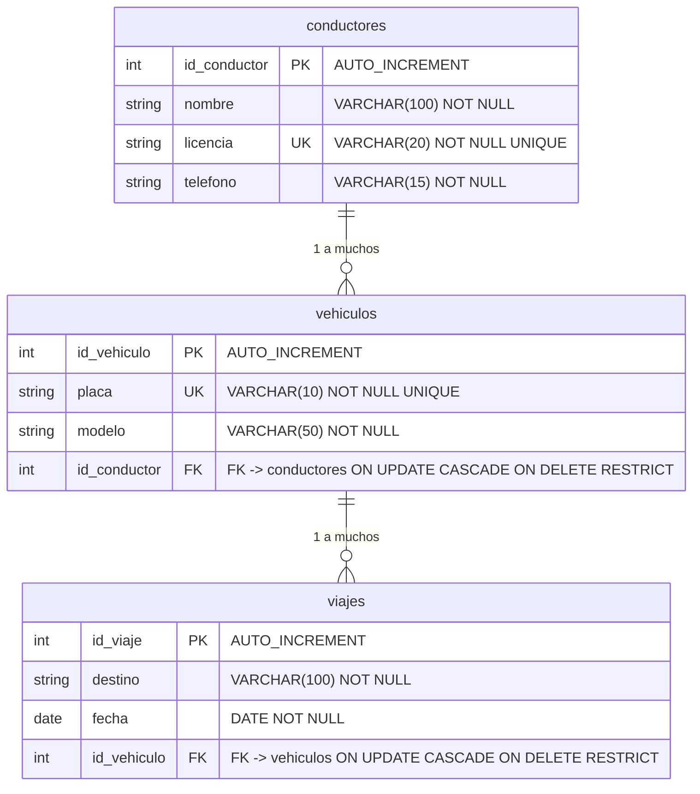

# Sistema de Gestión de Transporte - API REST

API REST profesional y modular para la gestión de transporte construida con **FastAPI**, **SQLAlchemy 2.0 (ORM tipado)** y **MySQL**, bajo una arquitectura desacoplada por capas (**Router -> Service -> Repository**) con inyección de dependencias (`Depends`), migraciones con **Alembic**, validaciones estrictas con **Pydantic v2** y suite exhaustiva de pruebas con **Pytest**.

---

## 📌 Modelo de Dominio y Base de Datos

El sistema modela la operación de transporte vehicular mediante tres entidades relacionadas:



---

## 🏗️ Arquitectura por Capas

```
Petición Cliente HTTP
        │
        ▼
[Router (app/api/)]
        │ - Valida esquemas DTO (Pydantic v2)
        │ - Traduce excepciones de dominio a códigos HTTP (404, 409, 422)
        ▼
[Service (app/services/)]
        │ - Aplica reglas de negocio (unicidad, relaciones, validaciones)
        │ - Desacoplado del protocolo HTTP (lanza excepciones de dominio)
        ▼
[Repository (app/repositories/)]
        │ - Acceso exclusivo a datos con SQLAlchemy 2.0 (select, joinedload)
        │ - Captura IntegrityError (rollback) y traduce colisiones concurrentes
        ▼
[Base de Datos (MySQL)]
```

---

## 🛠️ Stack Tecnológico

- **Python**: 3.11+
- **Framework Web**: FastAPI + Uvicorn
- **ORM**: SQLAlchemy 2.0 (`Mapped`, `mapped_column`, `relationship`, `joinedload`)
- **Driver MySQL**: PyMySQL + Cryptography
- **Migraciones de BD**: Alembic
- **Validación y Configuración**: Pydantic v2 + Pydantic-Settings
- **Testing y Calidad**: Pytest, Pytest-cov, HTTPX, Black, Flake8

---

## 🚀 Instalación y Puesta en Marcha

### 1. Clonar y Crear Entorno Virtual

En Windows (PowerShell):
```powershell
python -m venv .venv
.venv\Scripts\Activate.ps1
```

En Linux / macOS:
```bash
python3 -m venv .venv
source .venv/bin/activate
```

### 2. Instalar Dependencias

```powershell
# Producción
pip install -r requirements.txt

# Entorno de desarrollo, pruebas y linters
pip install -r requirements-dev.txt
```

### 3. Configuración de Variables de Entorno

Copia el archivo `.env.example` a `.env` y configura las credenciales de tu base de datos:

```bash
cp .env.example .env
```

Contenido de `.env.example`:
```ini
DB_USER=root
DB_PASSWORD=secret
DB_HOST=localhost
DB_PORT=3306
DB_NAME=transporte_db
```

> **Nota de seguridad**: El archivo `.env` está estrictamente ignorado en `.gitignore` para evitar filtración de contraseñas.

---

## 🗄️ Base de Datos y Migraciones (Alembic)

### Base de Datos Local con Docker Compose (Opcional)
```bash
docker compose up -d
```

### Migraciones con Alembic
El proyecto utiliza **Alembic** para versionar la base de datos:

1. **Si la base de datos ya contiene las tablas creadas**, márcala como sincronizada:
   ```bash
   alembic stamp head
   ```

2. **Si estás en una base de datos nueva/vacía**, aplica las migraciones:
   ```bash
   alembic upgrade head
   ```

3. **Verificar la versión actual**:
   ```bash
   alembic current
   ```

### Carga de Datos Semilla (Idempotente)
Se incluye un script para poblar la base de datos con 5 conductores, 5 vehículos y 8 viajes en Medellín:
```bash
python scripts/seed.py
```
*(Puede ejecutarse múltiples veces de forma segura sin generar duplicados).*

---

## ▶️ Ejecución de la API

Inicia el servidor en modo desarrollo:
```bash
uvicorn app.main:app --reload
```

- **Swagger UI**: [http://127.0.0.1:8000/docs](http://127.0.0.1:8000/docs)
- **ReDoc**: [http://127.0.0.1:8000/redoc](http://127.0.0.1:8000/redoc)
- **Health Check**: [http://127.0.0.1:8000/health](http://127.0.0.1:8000/health)

---

## 🧪 Pruebas Automatizadas y Calidad

Las pruebas utilizan una base de datos SQLite en memoria con `PRAGMA foreign_keys=ON` y la dependencia `get_db` sobrescrita, garantizando total independencia del servidor MySQL.

### Ejecutar Pruebas con Cobertura de Código (> 85%)
```bash
pytest -v --cov=app --cov-report=term-missing
```

### Comprobación de Estilo (PEP 8)
```bash
# Formateo
black --check app tests scripts

# Linter Flake8 (max-line-length 88)
flake8 app tests scripts
```

---

## 📡 Catálogo de Endpoints

Todos los endpoints de la API están prefijados bajo `/api/v1` (excepto `/health`):

### 🚗 Conductores (`/api/v1/conductores`)

| Método | Endpoint | Código Éxito | Descripción |
|---|---|---|---|
| `GET` | `/api/v1/conductores` | `200 OK` | Listar conductores (paginado `skip`, `limit`) |
| `GET` | `/api/v1/conductores/{id}` | `200 OK` | Obtener conductor por ID (`404` si no existe) |
| `GET` | `/api/v1/conductores/{id}/vehiculos` | `200 OK` | Listar vehículos asignados al conductor |
| `POST` | `/api/v1/conductores` | `201 Created` | Crear conductor (`409` si licencia ya existe) |
| `PUT` | `/api/v1/conductores/{id}` | `200 OK` | Reemplazo completo de conductor |
| `PATCH` | `/api/v1/conductores/{id}` | `200 OK` | Actualización parcial (`422` si envía null) |
| `DELETE` | `/api/v1/conductores/{id}` | `204 No Content` | Eliminar conductor (`409` si tiene vehículos) |

### 🚙 Vehículos (`/api/v1/vehiculos`)

| Método | Endpoint | Código Éxito | Descripción |
|---|---|---|---|
| `GET` | `/api/v1/vehiculos` | `200 OK` | Listar vehículos (paginado) |
| `GET` | `/api/v1/vehiculos/{id}` | `200 OK` | Obtener vehículo por ID |
| `GET` | `/api/v1/vehiculos/{id}/viajes` | `200 OK` | Listar viajes asignados al vehículo |
| `POST` | `/api/v1/vehiculos` | `201 Created` | Crear vehículo (`404` si conductor no existe, `409` si placa duplicada) |
| `PUT` | `/api/v1/vehiculos/{id}` | `200 OK` | Reemplazo completo de vehículo |
| `PATCH` | `/api/v1/vehiculos/{id}` | `200 OK` | Actualización parcial (`422` si envía null) |
| `DELETE` | `/api/v1/vehiculos/{id}` | `204 No Content` | Eliminar vehículo (`409` si tiene viajes) |

### 🛣️ Viajes (`/api/v1/viajes`)

| Método | Endpoint | Código Éxito | Descripción |
|---|---|---|---|
| `GET` | `/api/v1/viajes` | `200 OK` | Listar viajes con filtros (`fecha_desde`, `fecha_hasta`, `destino`, `id_vehiculo`, paginación) |
| `GET` | `/api/v1/viajes/detalle` | `200 OK` | **Reporte consolidado** con JOIN de las 3 tablas (optimizado con `joinedload`) |
| `GET` | `/api/v1/viajes/{id}` | `200 OK` | Obtener viaje por ID |
| `POST` | `/api/v1/viajes` | `201 Created` | Crear viaje (`404` si vehículo no existe) |
| `PUT` | `/api/v1/viajes/{id}` | `200 OK` | Reemplazo completo de viaje |
| `PATCH` | `/api/v1/viajes/{id}` | `200 OK` | Actualización parcial (`422` si envía null) |
| `DELETE` | `/api/v1/viajes/{id}` | `204 No Content` | Eliminar viaje |
